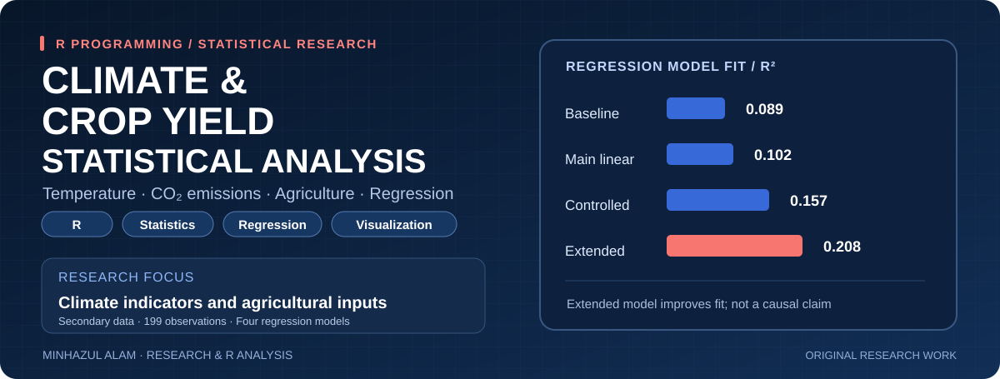
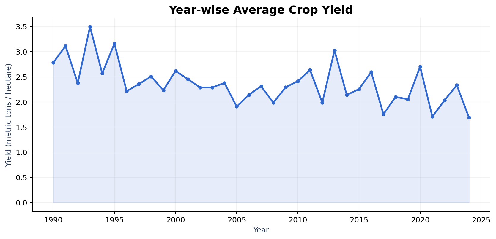
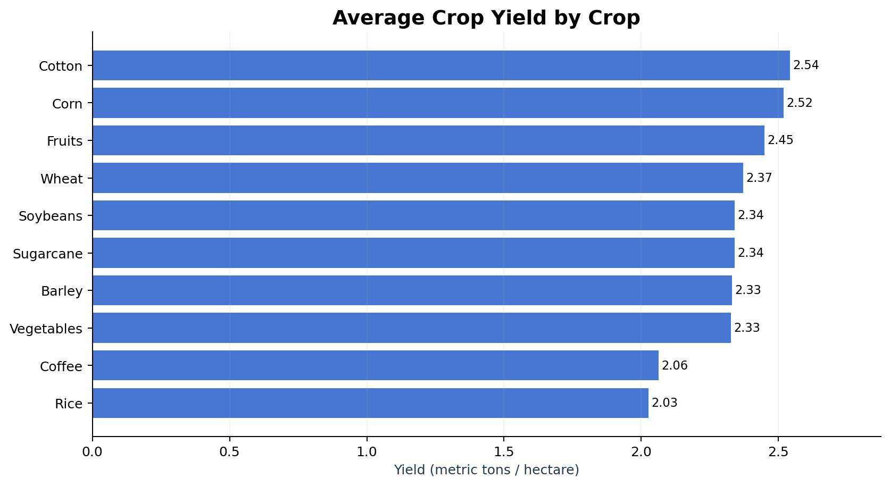
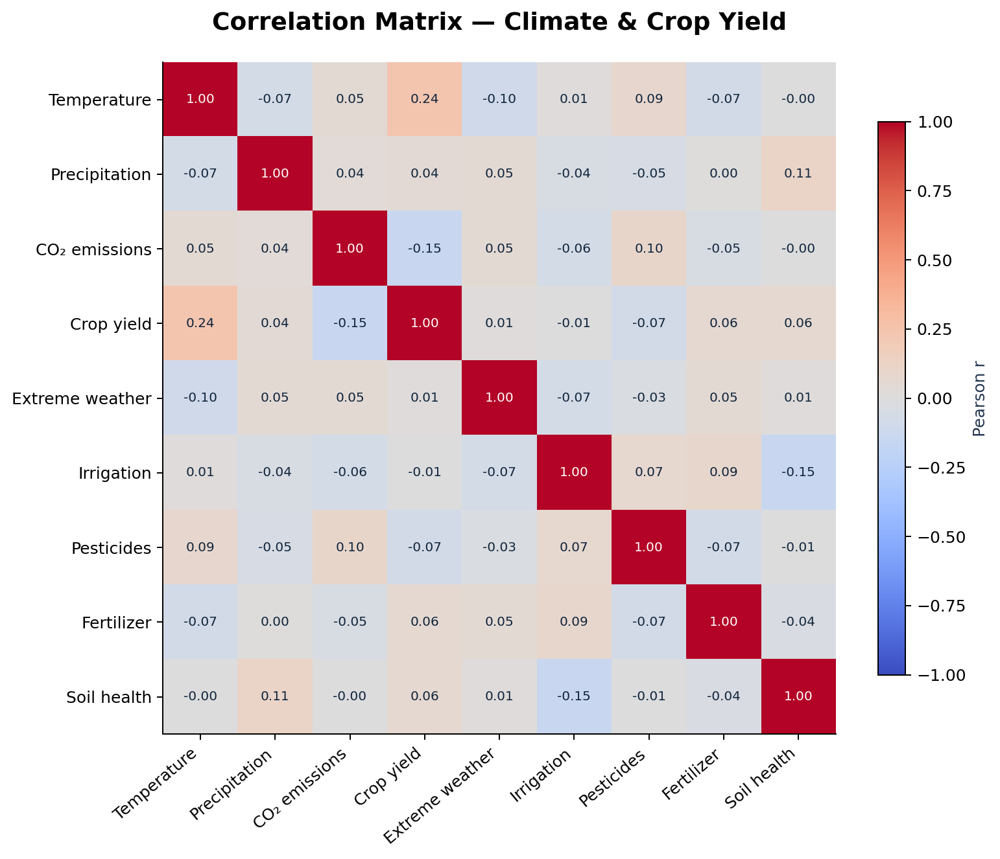
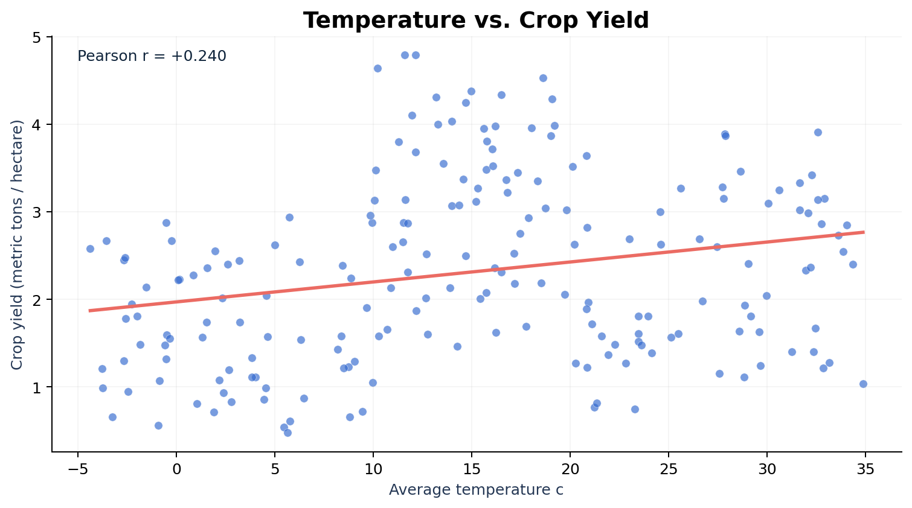
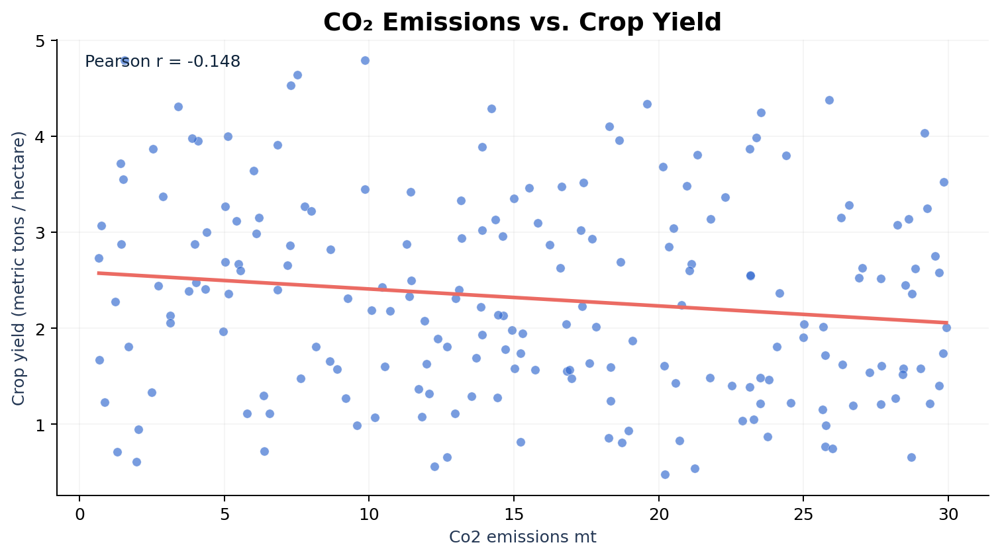
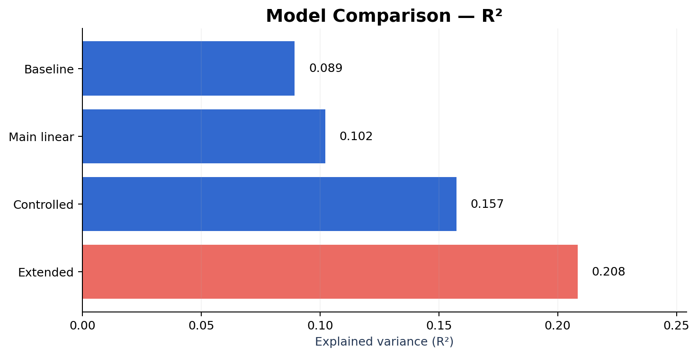
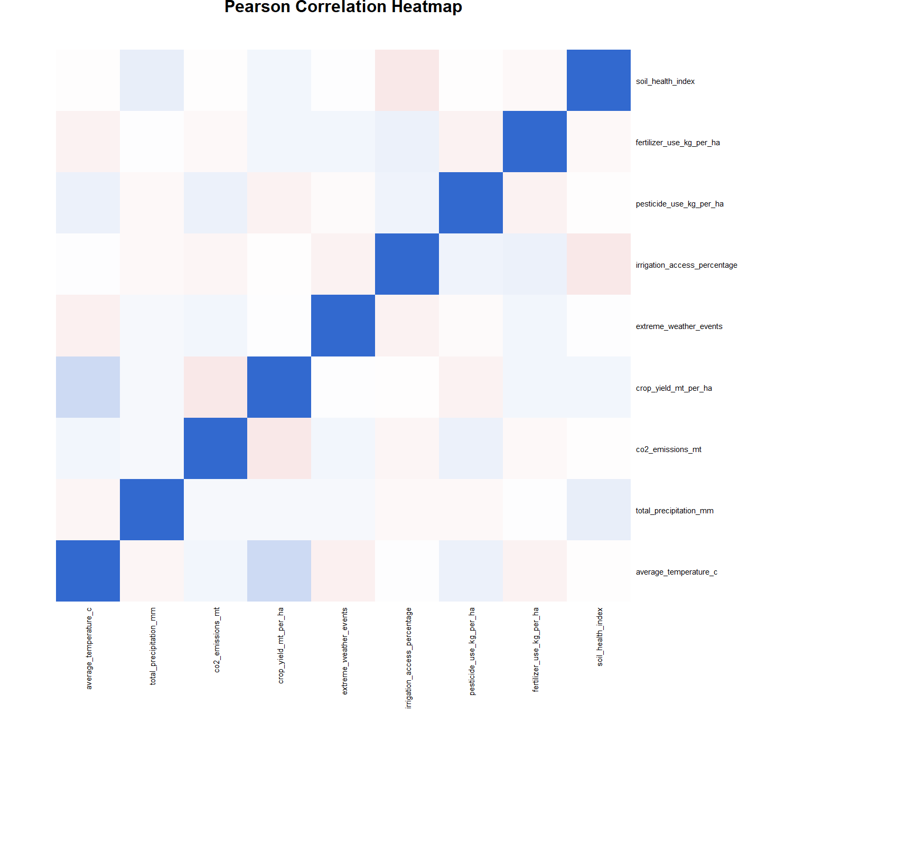
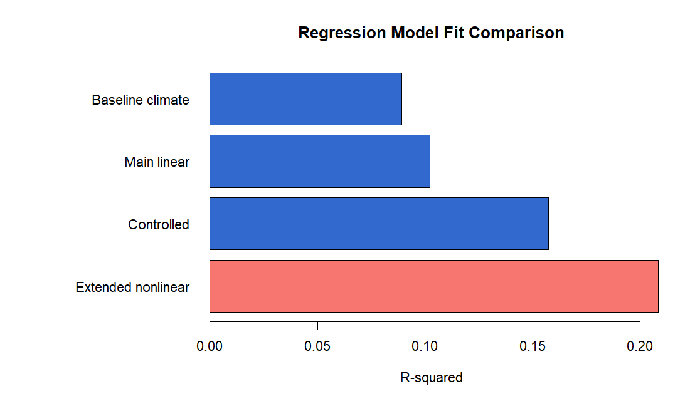

<div align="center">



### Climate indicators, agricultural inputs and crop-yield variation

**R · Statistical Modelling · Correlation · Visualization · Agriculture Research**

</div>

## Overview

This project showcases research, thesis manuscript development, R programming, statistical analysis, and data visualization work **completed by Minhazul Alam**, based on the research manuscript
*Impact of Climate Change Indicators and Agricultural Inputs on Crop Yield* (2026).
The dataset contains **199 observations and 15 fields** spanning 1990–2024, crop types and geographic regions.
The central question is how climate indicators and agricultural inputs are **associated** with crop yield.

**Research, thesis manuscript writing, R programming, and statistical analysis:** Minhazul Alam.  
**Project preparation:** Complete research workflow, data analysis, regression modelling, charts, and manuscript drafting were performed by Minhazul Alam (as clarified by the project creator).  
**Portfolio scope:** This project documents the work carried out by Minhazul Alam. It is not presented as a thesis formally submitted by him toward a degree.

> Research ethics: Models describe associations, not causal effects. The supplied thesis PDF and original exploratory draft are **not redistributed** in this repository. Dataset source and redistribution permission should be independently checked before a public upload.

## Featured analysis

| Component | Description |
|---|---|
| Descriptive analysis | Year-wise yield, crop-wise mean yield |
| Correlations | Pearson correlations across climate and agricultural variables |
| Baseline model | Four climate indicators |
| Main linear model | Climate indicators plus four agricultural inputs |
| Controlled model | Main model plus crop-type and adaptation-strategy controls |
| Extended nonlinear model | Main model plus squared terms for four climate indicators |

## Verified model comparison

The values below were **independently recomputed from the provided CSV** using OLS (Python `statsmodels`). They agree with the manuscript to rounding precision.

| Model | R² | Adjusted R² | Overall model p-value |
|---|---:|---:|---:|
| Baseline climate | 0.0892 | 0.0704 | 0.001116 |
| Main linear | 0.1022 | 0.0644 | 0.007713 |
| Controlled | 0.1574 | 0.0574 | 0.060068 |
| Extended nonlinear | **0.2084** | **0.1573** | **0.00001208** |

**Key findings:** Average temperature has a positive association with crop yield in the three linear specifications; CO₂ emissions have a negative association in those models. In the extended model, the negative and significant temperature-squared term points to a possible **nonlinear** relationship. Other explanatory variables are not statistically significant at 5% in the main model. The models explain a limited share of variation, so these findings should not be generalized as causal claims.

## Visual exploration

### 1 — Year-wise crop yield



### 2 — Crop comparison



### 3 — Correlation matrix



### 4 — Temperature and crop yield



### 5 — CO₂ emissions and crop yield



### 6 — Regression explanatory power



> The figures above were recomputed from the supplied CSV with Python for a verified portfolio preview. The provided base-R script generates equivalent analytical views; minor styling differences are expected.

## RStudio-Verified Visualizations

The following figures were generated using the
successfully executed base-R analysis script.

### Pearson Correlation Heatmap



### Regression Model Fit Comparison



All four OLS regression models were successfully
evaluated using 199 observations and 15 variables.

The extended nonlinear model achieved the highest
R-squared (0.2084), although the findings represent
statistical associations rather than causal effects.

## Reproduce with R

Install R from its official distribution, then from the **repository root** run:

```sh
Rscript src/analysis.R
```

No third-party R packages are required. The script reads `data/climate_agriculture.csv`, computes four OLS models and correlation estimates, then exports results to `results/` and charts to `figures/`.
To provide an alternate CSV path:

```sh
Rscript src/analysis.R path/to/your_dataset.csv
```

**Execution verification:** The R script was successfully executed locally in RStudio using R 4.4.2 and the original 199-observation dataset. All four regression model results matched the independently calculated Python results to rounding precision. Three CSV result files and six R-generated figures were produced successfully. No third-party R packages are required.

## Project structure

```text
README.md
assets/banner.svg
assets/banner_preview.png
data/climate_agriculture.csv
src/analysis.R
figures/01...06...png
results/model_comparison.csv
results/model_coefficients.csv
results/correlation_matrix.csv
docs/VERIFICATION_AND_PUBLICATION.md
```

## Related work

The separate [Climate & Agriculture SQL Analysis](https://github.com/minhaz6996/climate-agriculture-sql-analysis) focuses on PostgreSQL exploration and data transformation. **This repository** emphasizes R-based modelling, regression evaluation and visualization.

## Research credit & limitations

**Original research work, manuscript development, R scripting, statistical analysis and visualizations: Minhazul Alam.** This attribution reflects the creator's clarification regarding the work performed; a name appearing on an academic submission cover should not be automatically treated as proof of who carried out the research. This portfolio is **not** presented as a degree thesis formally submitted by Minhazul Alam. The dataset's source and redistribution license must be confirmed before a public upload. These data may combine regions, countries, crops and years; the regressions are not causal, pure time-series or panel causal identification models.

---

**Portfolio:** [minhaz6996](https://github.com/minhaz6996)
